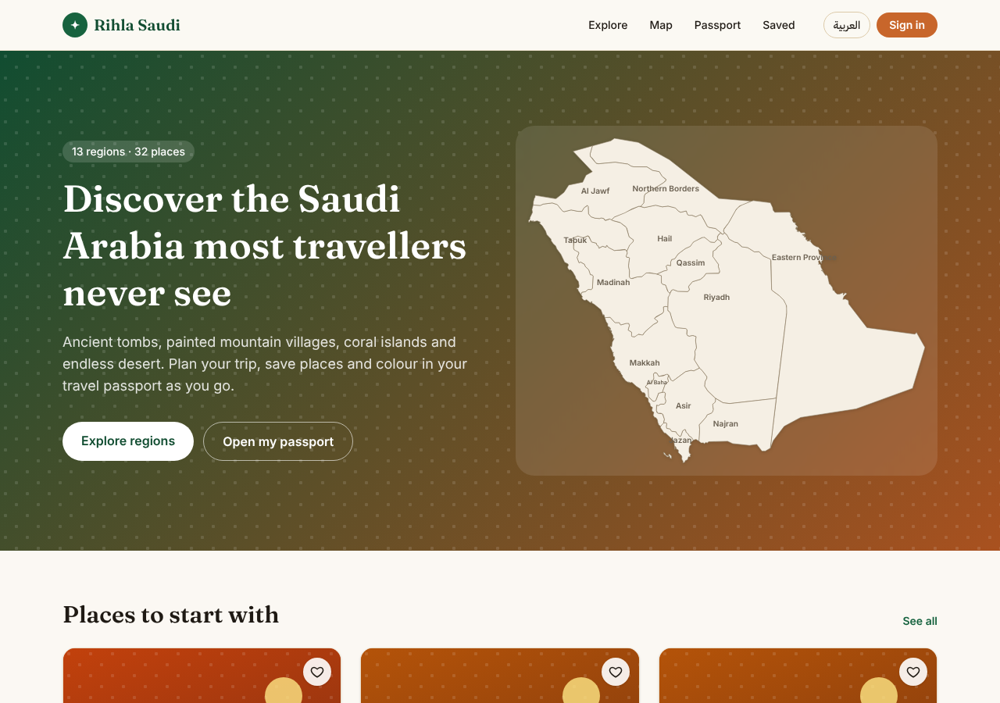

# Rihla Saudi

A bilingual (English and Arabic) travel guide to Saudi Arabia's 13 regions, with a personal "travel passport" map.

Built with **Next.js 15**, **TypeScript**, **Tailwind CSS 4**, **next-intl** and **Firebase** (sign-in and Firestore).



## What's in version 1

| Page | URL | What it does |
|---|---|---|
| Home | `/en`, `/ar` | Hero, featured places, all 13 regions |
| Explore | `/en/regions` | Region cards |
| Region | `/en/regions/asir` | Places in a region, with category filters |
| Place | `/en/places/hegra` | Description, best time, map, save and "I've been here" buttons |
| Map | `/en/map` | Every place on one map |
| Passport | `/en/passport` | Click regions to colour them in, with progress stats |
| Saved | `/en/saved` | Places the user saved |
| Sign in | `/en/login` | Google, or email and password |
| Profile | `/en/profile` | Stats and sign out |

- **Works without an account.** Saved and visited places are kept in the browser. When the user signs in, they move into their Firestore account automatically.
- **SEO.** Every page is pre-rendered, with titles, descriptions, English/Arabic alternate links, a `sitemap.xml`, `robots.txt` and schema.org `TouristAttraction` data on each place.
- **Right-to-left.** The Arabic pages use `dir="rtl"` and an Arabic font.

## Run it on your computer

You need [Node.js 20 or newer](https://nodejs.org).

```bash
npm install
npm run dev
```

Open http://localhost:3000 (it redirects to /en/ or /ar/).

## Firebase setup (one time)

The web config is already in `.env`. You only need to do this in the [Firebase console](https://console.firebase.google.com/project/rihla-saudi):

1. **Authentication → Sign-in method:** turn on **Google** and **Email/Password**.
2. **Authentication → Settings → Authorized domains:** add your live domain when you deploy (for example `rihla-saudi.vercel.app`). `localhost` is already allowed.
3. **Firestore Database:** click **Create database** (production mode, a region near your users, e.g. `me-central2`, Dammam).
4. **Deploy the security rules** in `firestore.rules`. They let each user read and write only their own document:

   ```bash
   npm install -g firebase-tools
   firebase login
   firebase deploy --only firestore:rules
   ```

   Or paste the contents of `firestore.rules` into **Firestore → Rules** and click **Publish**.

### Data model

One document per user at `users/{uid}`:

```json
{
  "displayName": "…",
  "email": "…",
  "saved": ["hegra", "farasan-islands"],
  "visitedPlaces": ["hegra"],
  "visitedRegions": ["asir", "riyadh"],
  "updatedAt": "<timestamp>"
}
```

## Deploy

The site is exported as static files (`npm run build` writes them to `out/`), so it can be hosted anywhere.

### GitHub Pages (set up)

Every push to `main` builds and publishes the site with `.github/workflows/deploy.yml`:

**https://mobaarok.github.io/rihla-saudi/**

For sign-in to work there, add `mobaarok.github.io` to Firebase **Authentication → Settings → Authorized domains**.

### Your own domain later

When you buy a domain, you can point it at GitHub Pages (repo **Settings → Pages → Custom domain**) or host the `out/` folder on Firebase Hosting, Vercel or Netlify. Then:

1. Remove `NEXT_PUBLIC_BASE_PATH` from the workflow, because a custom domain has no `/rihla-saudi` path.
2. Set `NEXT_PUBLIC_SITE_URL` to the new domain.
3. Add the domain to Firebase **Authorized domains**.
4. Submit `https://YOUR-DOMAIN/sitemap.xml` in [Google Search Console](https://search.google.com/search-console).

## Editing content

- **Site name:** `src/config/site.ts`
- **Default language:** `src/i18n/routing.ts` (`defaultLocale: 'ar'` makes the site Arabic-first)
- **Interface text:** `src/messages/en.json` and `src/messages/ar.json`
- **Regions:** `src/data/regions.ts`
- **Places:** `src/data/places.ts`. Copy an existing entry, give it a unique `slug`, and it gets its own page, sitemap entry and map pin automatically.
- **Photos:** add `image: { src, credit, license }` to a place. Use only photos you own or that are licensed (Wikimedia Commons, official press kits). Until then, places show generated cover art.

## ⚠️ Before launch

- **Check every fact.** Descriptions are drafts. Verify them against official sources such as visitsaudi.com, the Ministry of Culture and UNESCO.
- **Check coordinates.** Map pins are approximate.
- **Get the Arabic reviewed.** A native speaker should check all Arabic text.
- **Map tiles:** the free CARTO tiles in `src/components/PlacesMap.tsx` are for low traffic. For real traffic, move to a paid plan (MapTiler, Stadia or CARTO).

## Credits

- Region boundaries: [Natural Earth](https://www.naturalearthdata.com/) (public domain), simplified in `src/data/regionPaths.ts`.
- Map tiles: © OpenStreetMap contributors, © CARTO.

## Next steps (version 2)

- AI trip planner: a Next.js API route that calls the Claude API, with the key kept server-side in `.env.local`
- Real photos for every place
- More places (target: 100+)
- Transport info, quizzes, and affiliate links for hotels and tours
